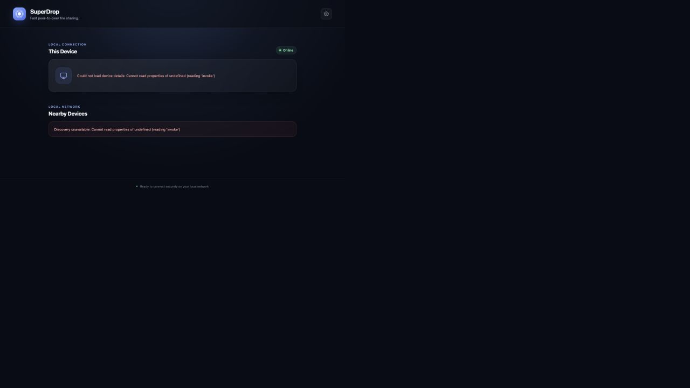

# SuperDrop

> **Status: work in progress.** Nearby-device discovery works; direct file transfer is still being built.

SuperDrop is a cross-platform desktop application for fast, direct file sharing between computers on the same local network. It is built with Tauri, React, TypeScript, and Rust. SuperDrop does not use cloud storage or user accounts.



## Current milestone

Milestone 2 adds automatic nearby-device discovery over mDNS. Each running instance advertises minimal, versioned device metadata and browses for other SuperDrop instances on the same local network. The UI refreshes the device list every two seconds and removes devices after their mDNS service disappears. File transfer is intentionally not implemented yet.

## Architecture

```text
src/                         React + TypeScript frontend
  components/                Focused UI components
  hooks/                     React state and native-data hooks
  services/                  Tauri command wrappers
  types/                     Shared frontend domain types
src-tauri/src/               Rust application backend
  commands.rs                Narrow commands exposed to the frontend
  network/discovery.rs       mDNS advertisement, browsing, and validation
  network/transfer.rs        Future transfer boundary
  lib.rs                     Tauri setup and command registration
  main.rs                    Native binary entry point
```

The frontend has no direct operating-system or network access. `deviceService.ts` calls the allowlisted `get_device_info` and `get_nearby_devices` Tauri commands through IPC. Rust owns the mDNS daemon and returns read-only, validated snapshots to React as typed objects.

## Prerequisites

- Node.js 20 or newer and npm
- Rust installed through [rustup](https://rustup.rs/)
- The [Tauri system prerequisites](https://v2.tauri.app/start/prerequisites/) for your operating system
  - macOS: Xcode Command Line Tools
  - Windows: Microsoft C++ Build Tools and WebView2
  - Linux: the WebKitGTK and related distribution packages listed by Tauri

On macOS, install the command-line tools with:

```sh
xcode-select --install
```

Install Rust with rustup, then restart your terminal so `cargo` is available:

```sh
curl --proto '=https' --tlsv1.2 -sSf https://sh.rustup.rs | sh
```

## Install and run

From the `SuperDrop` directory:

```sh
npm install
npm run tauri dev
```

Useful verification commands:

```sh
npm run build
cargo check --manifest-path src-tauri/Cargo.toml
npm run tauri build
```

`npm run dev` runs only the web UI. Because native commands are unavailable in a normal browser, use `npm run tauri dev` when testing real device information.

## Testing discovery

Run SuperDrop on two computers connected to the same non-guest Wi-Fi network. On macOS, approve the Local Network permission if prompted. Each computer should appear on the other within several seconds and disappear after SuperDrop is closed. Some guest, school, hotel, and corporate networks block peer-to-peer multicast traffic.

## Next milestone

Milestone 3 should add transfer negotiation only: selecting a discovered device, choosing a file through an explicit system dialog, sending bounded file metadata, and requiring the receiver to accept or decline. Actual file streaming should follow only after negotiation is reliable.

## Security direction

SuperDrop exposes only explicitly registered Tauri commands. Future discovery input will be treated as untrusted, incoming transfers will never be accepted automatically, received files will not be executed, and filesystem access will remain narrow and user-directed.
